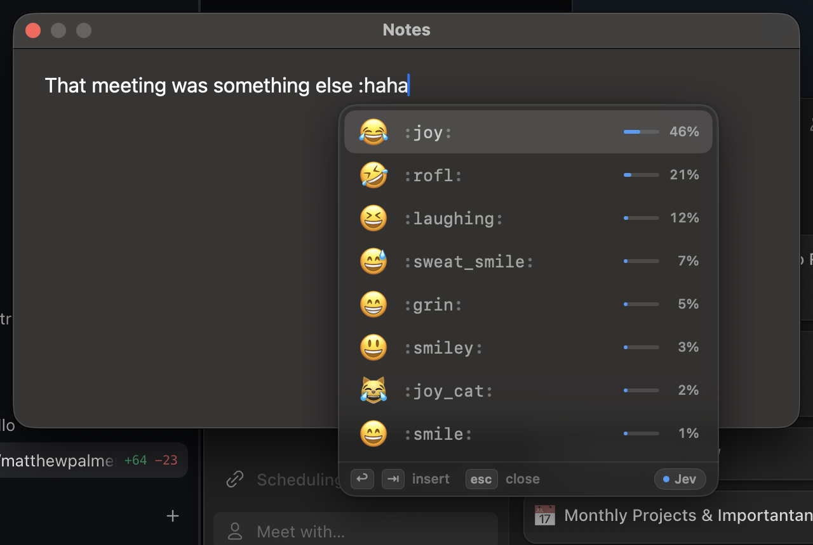
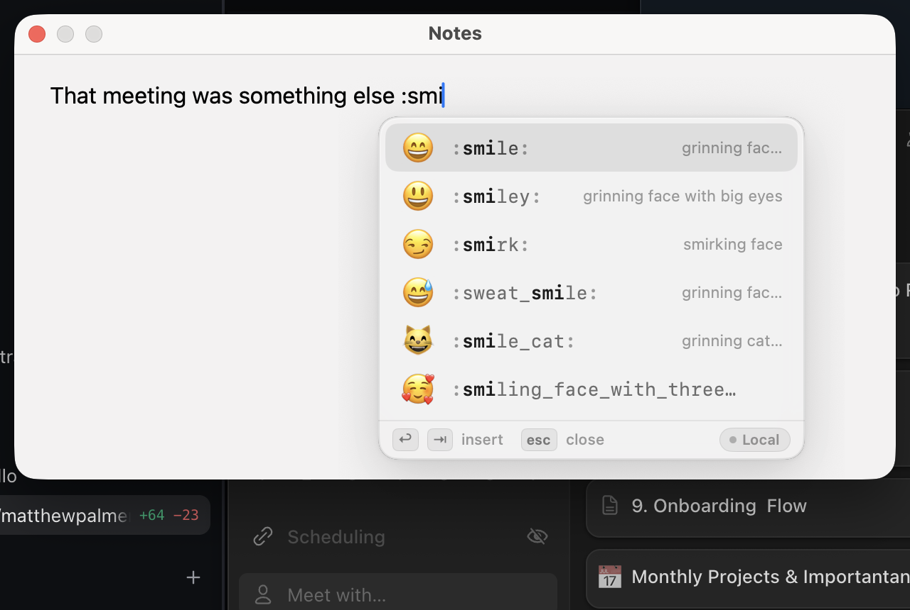

<div align="center">

# Emojify

**Slack-style `:emoji:` autocomplete in every Mac app.**

Type `:haha` anywhere. A glass picker appears right at your caret. Press Enter and get 😂.

[Download](https://github.com/Syfraxing/Emojify/releases/latest) ·
[Build from source](#build-from-source) ·
[Architecture](docs/ARCHITECTURE.md)


[](https://github.com/Syfraxing/Emojify/actions/workflows/ci.yml)



</div>

## Why Emojify

Slack, Discord and GitHub taught your fingers to type `:tada:`. Then you open Mail, Notes,
Messages or your editor, and nothing happens. Emojify brings that habit to the whole Mac:
it lives in the menu bar, stays out of the way, and turns `:shortcode` into emoji in any
text field.

It also knows what you *mean*, not just what you type. `:haha`, `:yay`, `:sus` and
`:oof` find the right emoji even though no emoji is named that, because results are
reranked by [Jev](https://typesafe.ai), TypeSafe AI's fast decision model.

## Features

- **`:haha` anywhere.** Works in native apps, browsers and Electron apps. Type the
  trigger at the start of a word, then a few letters. `http://` and `12:30` never trigger.
- **Instant and smart.** Local fuzzy search answers in under a millisecond, then Jev
  reranks the list about 150 ms later, smoothly, as you type. No key? Local search alone
  is still great.
- **Beautiful glass UI.** A translucent, non-activating panel that appears at the caret,
  follows light and dark mode, and never steals focus from the app you're typing in.
- **Keyboard first.** ↑ ↓ to choose, Enter or Tab to insert, Esc to dismiss and keep what
  you typed. Type a closing colon after an exact shortcode (`:joy:`) to insert it
  instantly.
- **Hotkey search.** Press <kbd>⌃</kbd><kbd>⌥</kbd><kbd>⌘</kbd><kbd>E</kbd> (customizable)
  to search all emoji from anywhere, then click or press Enter to insert.
- **Custom trigger.** Prefer `;` or `::`? Any one to three punctuation characters work;
  change it in Settings → General.
- **Excluded apps.** Out of the box Emojify stays silent in apps that have their own
  picker (Slack, Discord, Teams, Linear, Notion, GitHub Desktop), in terminals and code
  editors where `:` means something else (Terminal, iTerm2, Ghostty, Warp, VS Code, Xcode,
  Zed, Cursor), and in password managers (1Password, Bitwarden, Passwords, Keychain
  Access). Add or remove apps in Settings → Excluded Apps.
- **Skin tones** applied automatically wherever an emoji supports them.
- **Frecency.** Emoji you use often and recently float to the top.
- **Private by design.** Never active in password fields, never keeps a log of your
  typing, and Jev is optional. See [Privacy](#privacy).

## Screenshots

| Inline picker (dark) | Inline picker (light) |
| --- | --- |
|  |  |

| Hotkey search | Settings |
| --- | --- |
|  |  |

## Install

1. Download `Emojify-<version>.dmg` (or the `.zip`) from the
   [latest release](https://github.com/Syfraxing/Emojify/releases/latest).
2. Open it and drag **Emojify** into **Applications**.
3. **First launch.** Release builds are not notarized by Apple yet, so Gatekeeper refuses
   to open the app the first time. Pick one:
   - **macOS 15 Sequoia and later:** open Emojify, click **Done** on the warning, then go to
     **System Settings → Privacy & Security**, scroll down to *"Emojify" was blocked* and
     click **Open Anyway**.
   - **macOS 14 Sonoma:** right-click (or Control-click) Emojify in Applications, choose
     **Open**, then **Open** again.
   - **Any version:** remove the quarantine flag in Terminal:
     ```sh
     xattr -dr com.apple.quarantine /Applications/Emojify.app
     ```
4. **Grant Accessibility.** Emojify needs it to see your keystrokes and type the emoji.
   The onboarding window takes you to **System Settings → Privacy & Security →
   Accessibility**; switch Emojify on and it starts working immediately. Install the app in
   Applications *before* granting, and don't move it afterwards.

Emojify lives in the menu bar (there's no Dock icon). Click the menu bar icon for
Settings, the on/off toggle and Quit. Turn on **Launch at login** in Settings → General.

> **Updating or stuck?** macOS ties the Accessibility permission to the app's signature,
> and release builds are ad-hoc signed, so after installing a new release Emojify may show
> "Accessibility permission needed" even though the switch looks on. Remove Emojify from
> the Accessibility list (−) and add it again, or reset the permission in Terminal and
> grant it once more:
> ```sh
> tccutil reset Accessibility so.slayer.Emojify
> ```
> If Emojify goes quiet everywhere, check the menu bar: *Paused — secure input* means
> another app (often a password prompt or a terminal) has turned on macOS Secure Input.

## Jev ranking (bring your own key)

Emojify works fully offline with local search. For semantic ranking, add a Jev key:

1. Get a key at [console.typesafe.ai](https://console.typesafe.ai).
2. Click the menu bar icon → **Settings… → Jev**, paste the key, and press **Test**.

The key is stored in your macOS **Keychain** and is only ever sent to
`api.typesafe.ai`. It is never written to disk in plain text, logged or synced anywhere
else. Debug builds (`swift run`) also accept a `JEV_API_KEY` environment variable for
development; release builds read the Keychain only.

## Privacy

Emojify needs Accessibility access, which is powerful, so here is exactly what it does
with it.

**On your Mac**
- Emojify watches keystrokes only to spot the trigger. Outside an active `:query` it
  keeps nothing: no buffer, no history, no log of what you type.
- It is silent in secure text fields (passwords), whenever macOS Secure Input is on, while
  an input method (Japanese, Chinese, Korean…) is active, in excluded apps (password
  managers and terminals by default), and in its own windows.
- Settings and emoji usage counts (for frecency) are stored locally in Emojify's
  preferences. Your Jev key is stored in the Keychain.

**Sent to Jev** only when a key is set, **Use Jev** is on, and your query is at least two
characters long. Requests go over HTTPS to `api.typesafe.ai` with no cookies or cache, and
contain:
- the query you typed after the trigger (e.g. `haha`);
- the candidate emoji being ranked (emoji, name, keywords);
- the name and bundle ID of the app you're typing in (e.g. `Mail`, `com.apple.mail`);
- **only if you opt in** to **Send text context** (off by default, Settings → Jev): up to
  300 characters of the text right before the trigger, read from the focused field at that
  moment so suggestions fit the sentence. Never read from password fields.

Nothing is sent when Jev is off or no key is set. Emojify has no analytics or telemetry,
and it never logs your keys, queries or typed text.

## Build from source

Requires macOS 14+ and Xcode 16+ (Swift 6 toolchain).

```sh
git clone https://github.com/Syfraxing/Emojify.git
cd Emojify
make install          # build, sign, copy to /Applications, launch
```

| Command | What it does |
| --- | --- |
| `make app` | Universal (arm64 + x86_64) release build, signed, at `build/Emojify.app`. `NATIVE=1` builds for this Mac only. |
| `make install` | `make app`, quit the running copy, install to `/Applications` (or `~/Applications`), launch. |
| `make dmg` | Drag-to-install disk image at `dist/Emojify-<version>.dmg`. |
| `make test` | `swift test`. |
| `make build` | Plain debug `swift build`. |
| `make emoji-data` | Regenerate the bundled emoji dataset. |
| `make icon` | Regenerate the app icon. |
| `make clean` | Remove `.build`, `build`, `dist`. |

**Code signing.** `scripts/build-app.sh` signs with the `SIGN_IDENTITY` environment
variable if set; otherwise it uses your first *Developer ID Application* certificate, then
*Apple Development*, then any other valid code-signing identity in your keychain (a
self-signed certificate works), and falls back to ad-hoc signing. Use a certificate if you
can: macOS ties the Accessibility permission to the signature's designated requirement,
and an ad-hoc signature changes on every build, so you'd have to re-grant Accessibility
(`tccutil reset Accessibility so.slayer.Emojify`) after each rebuild. Developer ID builds
also get the hardened runtime and a secure timestamp.

```sh
SIGN_IDENTITY="Developer ID Application: Your Name (TEAMID)" make dmg
SIGN_IDENTITY=- make app          # force ad-hoc
EMOJIFY_VERSION=1.2.0 make app    # override the version string
```

**Releases.** Pushing a `v*` tag runs `.github/workflows/release.yml`, which tests,
builds an ad-hoc signed universal app, and attaches the `.zip`, `.dmg` and
`SHA256SUMS.txt` to a GitHub Release. CI also scans every commit for anything that looks
like an API key or token.

## How it works

A `CGEventTap` feeds keystrokes to a small, unit-tested state machine that recognizes
`:query` at word boundaries. The query goes to a local index (shortcodes, names,
keywords, fuzzy subsequence, frecency); the top candidates plus a pool of popular emoji
are sent to Jev as a single choice question, and the results are blended and animated in
place. The emoji is inserted by synthesizing Unicode keystrokes (or a clipboard paste that
restores your clipboard afterwards). The details are in
[docs/ARCHITECTURE.md](docs/ARCHITECTURE.md).

## Contributing

Issues and pull requests are welcome. See [CONTRIBUTING.md](CONTRIBUTING.md).

## Credits & licenses

- Emojify is released under the [MIT License](LICENSE). © 2026 Hunter Claycomb.
- [KeyboardShortcuts](https://github.com/sindresorhus/KeyboardShortcuts) by Sindre Sorhus
  (MIT) powers the global hotkey and its recorder.
- Emoji names and keywords come from Unicode emoji data; see
  `scripts/build-emoji-data.py` for the exact sources and their licenses.
- Ranking by [Jev](https://typesafe.ai) from TypeSafe AI.
- Inspired by [Rocket](https://matthewpalmer.net/rocket/), which showed how good
  system-wide emoji autocomplete can feel.
